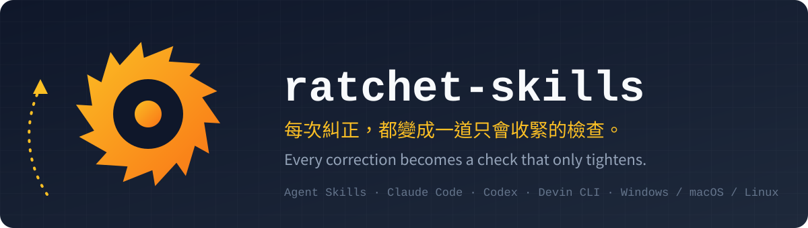
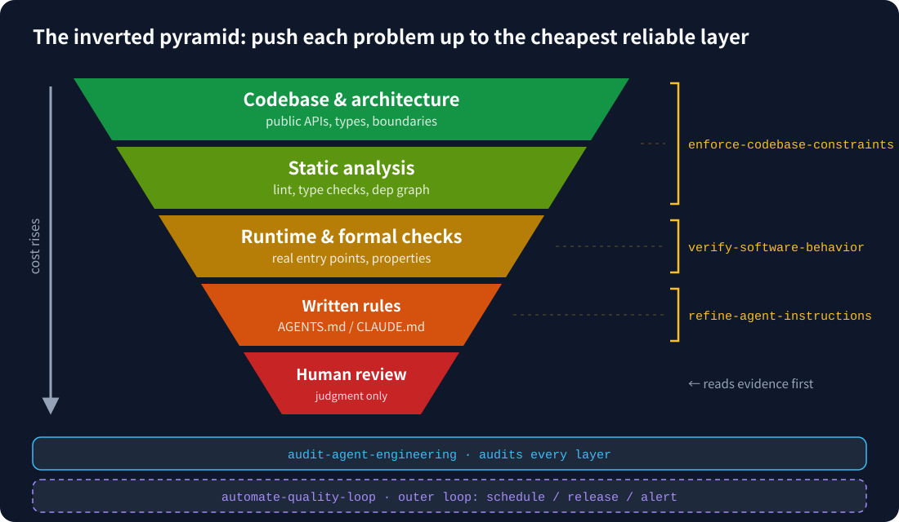
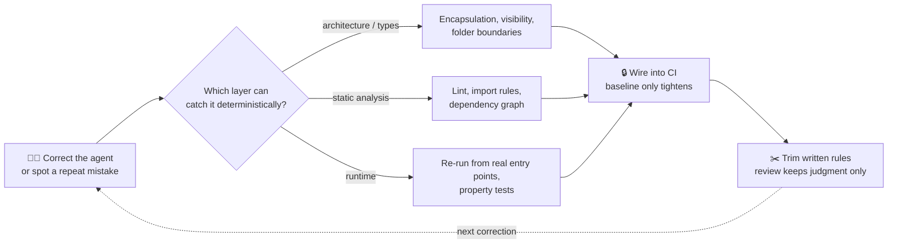

<p align="center">
  
</p>

<p align="center">
  <a href="README.md">繁體中文</a> · <b>English</b>
</p>

<p align="center">
  <a href="https://agentskills.io/specification"></a>
  
  
  
  
  <a href="LICENSE"></a>
</p>

---

**ratchet-skills** is a set of [Agent Skills](https://agentskills.io/specification) for AI coding agents. It moves the job of keeping agent-written code clean away from human review and up into cheaper, more reliable mechanisms: codebase structure, static checks, and behavior checks you can re-run.

The name comes from a **ratchet**, which turns one way and never slips back. Each time you correct an agent, that correction becomes a deterministic check. The violation baseline only tightens, so you never catch the same class of mistake in review twice.

> **Language note:** the skill bodies (`SKILL.md`) are written in Traditional Chinese. Agents follow them fine in any language and reply in yours. English translations are welcome as PRs.

## Why

Agents treat the code already in your repo as a template. Every workaround that lands makes the next copy more likely. Adding more prose to `AGENTS.md` or relying on reviewers to catch it is the most expensive and least reliable fix.

<p align="center">
  
</p>

Cost rises from top to bottom. The rule: **find the earliest layer that can reliably catch the problem and push the problem up there**, so human review is left with only the calls that need judgment.

## The ratchet loop



## Skills

| | Skill | Use it when |
| :-: | --- | --- |
| 🔍 | [`audit-agent-engineering`](skills/audit-agent-engineering/SKILL.md) | You want to audit the setup from codebase to human review and rank which gap to fix first, based on evidence. |
| 🔒 | [`enforce-codebase-constraints`](skills/enforce-codebase-constraints/SKILL.md) | You just corrected the agent, or keep seeing the same API misuse or cross-layer import. Turns it into an API wrapper, type, lint or dependency-boundary check and cleans up existing violations. |
| 🧪 | [`verify-software-behavior`](skills/verify-software-behavior/SKILL.md) | You need runtime evidence. Re-runs user flows from real entry points and picks property tests, state machines or formal methods by risk. |
| ✂️ | [`refine-agent-instructions`](skills/refine-agent-instructions/SKILL.md) | You want to slim down `AGENTS.md` / `CLAUDE.md`, review rules the agent added, and confirm automated checks now cover them. |
| 🔁 | [`automate-quality-loop`](skills/automate-quality-loop/SKILL.md) | The inner loop is stable and you want quality runs triggered by schedules, releases or alerts, with failure triage and approved fix PRs. |

Suggested order: `audit` first → add checks and evidence with `enforce` and `verify` → trim prose with `refine` → once the inner loop is stable, consider `automate`. Each skill also works on its own.

## Install

Skills are plain Markdown folders, so **they work the same on every OS**. Installing means copying `skills/<name>/` into a folder your agent scans.

| Agent | Project | User | Docs |
| --- | --- | --- | --- |
| Claude Code | `.claude/skills/` | `~/.claude/skills/` | [Skills](https://code.claude.com/docs/en/skills) |
| Codex | `.agents/skills/` | `~/.agents/skills/` | [Skills](https://developers.openai.com/codex/skills) |
| Devin CLI | `.agents/skills/` | `~/.agents/skills/` | [Skills](https://docs.devin.ai/cli/extensibility/skills/overview) |

> On Windows, `~` means `%USERPROFILE%` (for example `C:\Users\you`). Codex and Devin CLI share `.agents/skills/`.

### 1. Get the source

```bash
git clone https://github.com/danieltsai0423/ratchet-skills.git
cd ratchet-skills
```

### 2. Run the installer

By default it installs **every skill** at **user level**, for both Claude Code (`~/.claude/skills`) and Codex / Devin (`~/.agents/skills`).

<table>
<tr><th>🪟 Windows (PowerShell 5.1 / 7)</th><th>🍎 macOS · 🐧 Linux · WSL · Git Bash</th></tr>
<tr><td>

```powershell
.\install.ps1
```

</td><td>

```bash
./install.sh
```

</td></tr>
</table>

Common options (both installers take the same ones):

| Goal | PowerShell | sh |
| --- | --- | --- |
| List skills | `.\install.ps1 -List` | `./install.sh --list` |
| Claude Code only | `.\install.ps1 -Agent claude` | `./install.sh --agent claude` |
| Install into a project | `.\install.ps1 -Project ..\my-app` | `./install.sh --project ../my-app` |
| Pick specific skills | `.\install.ps1 verify-software-behavior` | `./install.sh verify-software-behavior` |
| Replace existing skills | `.\install.ps1 -Force` | `./install.sh --force` |

> If Windows blocks the script, run `powershell -ExecutionPolicy Bypass -File .\install.ps1`, which affects only that run. On macOS / Linux, use `sh install.sh` if you get "permission denied".

<details>
<summary><b>Other ways to install</b></summary>

**With the [`skills`](https://github.com/vercel-labs/skills) CLI (needs Node.js)**, no clone required, with interactive skill and agent selection:

```bash
npx skills add danieltsai0423/ratchet-skills
```

**By hand:** copy the folders you want from `skills/` into a directory from the table above. Keep `SKILL.md` together with its `references/` and `agents/` folders so the relative links still work.

</details>

### 3. Use it

Start a new agent session and point it at a project or module:

| Agent | How to call it |
| --- | --- |
| Claude Code / Devin CLI | `/audit-agent-engineering audit this repo and list what to fix first` |
| Codex | `$audit-agent-engineering audit this repo and list what to fix first` |

You can also just describe the need, for example "turn that cross-layer import mistake into a lint rule", and the agent loads the matching skill from its description.

## Layout

```text
ratchet-skills/
├── skills/
│   └── <skill-name>/
│       ├── SKILL.md            # the skill (frontmatter: name, description)
│       ├── references/         # extra detail, read on demand
│       └── agents/openai.yaml  # Codex UI metadata
├── install.ps1                 # Windows PowerShell 5.1 / PowerShell 7 (cross-platform)
├── install.sh                  # macOS / Linux / WSL / Git Bash
├── assets/                     # README images (built by scripts/gen_assets.py)
└── .github/workflows/ci.yml    # validates skills and installers on Windows, macOS, Linux
```

## Contributing

Issues and PRs are welcome. When adding or changing a skill:

- The folder name must match the `name` in the `SKILL.md` frontmatter: lowercase, hyphenated.
- The `description` should say **when to use** the skill. Agents rely on it to decide whether to load it.
- Keep `SKILL.md` short. Put long material in `references/` and link to it.
- CI checks frontmatter and runs both installers on all three operating systems.

## Credits

The core idea comes from Lauren Tan's AI Engineer Code Summit talk [All Code Is Slop (Except Mine)](https://www.youtube.com/watch?v=O_zcc6Xl12g), which walks the inverted pyramid of codebase, static analysis, verification, written rules and human review. The skills here are working procedures written from those ideas, not a transcript of the talk, and are not reviewed or endorsed by the speaker. The Electron, React and formal-methods practices from the talk appear in the skills as examples for the situations where they fit.

## License

[MIT](LICENSE)
