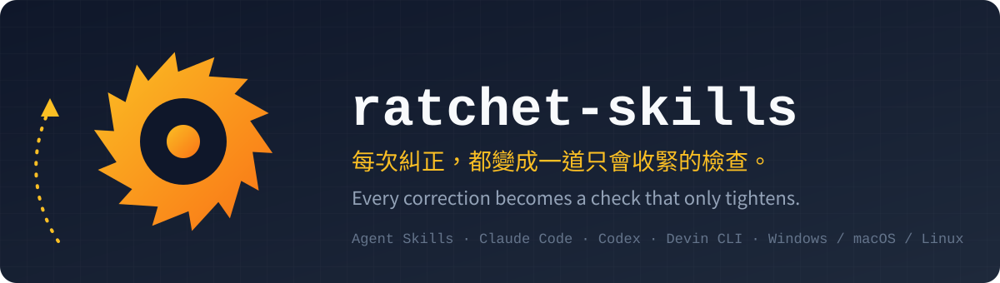
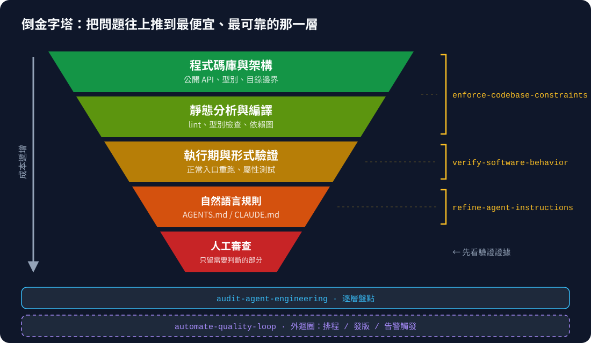
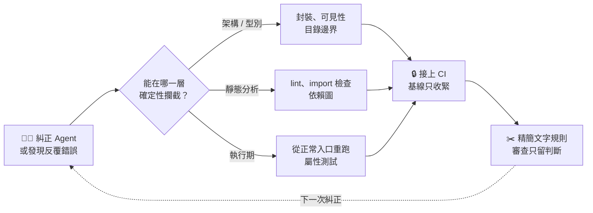

<p align="center">
  
</p>

<p align="center">
  <b>繁體中文</b> · <a href="README.en.md">English</a>
</p>

<p align="center">
  <a href="https://agentskills.io/specification"></a>
  
  
  
  
  <a href="LICENSE"></a>
</p>

---

**ratchet-skills** 是一組給 AI coding agent 用的 [Agent Skills](https://agentskills.io/specification)。它把「Agent 寫出來的程式碼品質」這件事，從人工審查往上推到更便宜、更可靠的機制：程式碼庫結構、靜態檢查、可重跑的行為驗證。

名字取自**棘輪（ratchet）**：只能往一個方向轉緊，不會鬆回去。每次你糾正 Agent，就把那次糾正變成一道確定性檢查；違規基線只會收緊，同一類錯誤不必在審查裡再抓第二次。

> 💡 演講者本人的官方完整版是 [pstack](https://github.com/cursor/plugins/tree/main/pstack)。兩者怎麼選，見 [與 pstack 的差異](#與-pstack-的差異)。

## 為什麼需要它

Agent 會把程式碼庫裡的既有寫法當成範本。每多一份權宜寫法，下一次被複製的機率就更高。只靠在 `AGENTS.md` 加文字規則、或靠人工 review 硬抓，成本最高，也最不可靠。

<p align="center">
  
</p>

倒金字塔由上到下成本遞增。原則是：**找到最早能可靠攔截問題的那一層，把問題推上去處理**，讓人工審查只剩真正需要判斷的部分。

## 棘輪迴圈



## 技能一覽

| | 技能 | 什麼時候用 |
| :-: | --- | --- |
| 🔍 | [`audit-agent-engineering`](skills/audit-agent-engineering/SKILL.md) | 盤點從程式碼庫到人工審查的工程環境，依證據排出最值得先修的缺口。 |
| 🔒 | [`enforce-codebase-constraints`](skills/enforce-codebase-constraints/SKILL.md) | 把每次糾正、反覆出現的 API 誤用或跨層引用，轉成 API 封裝、型別、lint 或依賴邊界檢查，並清掉既有錯誤模式。 |
| 🧪 | [`verify-software-behavior`](skills/verify-software-behavior/SKILL.md) | 從正常入口驗證軟體行為，依風險選擇屬性測試、狀態機或形式驗證，為審查提供可重跑的證據。 |
| ✂️ | [`refine-agent-instructions`](skills/refine-agent-instructions/SKILL.md) | 精簡 `AGENTS.md`／`CLAUDE.md`，審核 Agent 新增的規則，確認自動檢查已覆蓋原本的要求。 |
| 🔁 | [`automate-quality-loop`](skills/automate-quality-loop/SKILL.md) | 內迴圈穩定後，導入由排程、發版或告警觸發的品質測試、失敗分流與經授權的修復 PR。 |

建議順序：先用 `audit` 盤點 → 用 `enforce` 和 `verify` 補上檢查與證據 → 用 `refine` 精簡文字規則 → 內迴圈穩定後再考慮 `automate`。每個技能都能獨立載入。

## 安裝

技能就是純 Markdown 資料夾，**在任何作業系統上都一樣**。安裝只是把 `skills/<名稱>/` 整個資料夾複製到 Agent 會掃描的目錄。

| Agent | 專案層級 | 使用者層級 | 官方文件 |
| --- | --- | --- | --- |
| Claude Code | `.claude/skills/` | `~/.claude/skills/` | [Skills](https://code.claude.com/docs/en/skills) |
| Codex | `.agents/skills/` | `~/.agents/skills/` | [Skills](https://developers.openai.com/codex/skills) |
| Devin CLI | `.agents/skills/` | `~/.agents/skills/` | [Skills](https://docs.devin.ai/cli/extensibility/skills/overview) |

> Windows 上 `~` 指的是 `%USERPROFILE%`（例如 `C:\Users\you`）。Codex 與 Devin CLI 共用 `.agents/skills/`。

### 1. 取得原始碼

```bash
git clone https://github.com/danieltsai0423/ratchet-skills.git
cd ratchet-skills
```

### 2. 執行安裝器

預設會把**全部技能**裝到**使用者層級**，同時給 Claude Code（`~/.claude/skills`）與 Codex／Devin（`~/.agents/skills`）。

<table>
<tr><th>🪟 Windows（PowerShell 5.1 / 7）</th><th>🍎 macOS · 🐧 Linux · WSL · Git Bash</th></tr>
<tr><td>

```powershell
.\install.ps1
```

</td><td>

```bash
./install.sh
```

</td></tr>
</table>

常用參數（兩個安裝器參數對應一致）：

| 需求 | PowerShell | sh |
| --- | --- | --- |
| 列出所有技能 | `.\install.ps1 -List` | `./install.sh --list` |
| 只裝給 Claude Code | `.\install.ps1 -Agent claude` | `./install.sh --agent claude` |
| 裝進某個專案 | `.\install.ps1 -Project ..\my-app` | `./install.sh --project ../my-app` |
| 只裝特定技能 | `.\install.ps1 verify-software-behavior` | `./install.sh verify-software-behavior` |
| 覆蓋已存在的同名技能 | `.\install.ps1 -Force` | `./install.sh --force` |

> 若 Windows 擋下腳本執行，改用 `powershell -ExecutionPolicy Bypass -File .\install.ps1`；這只影響這一次執行。macOS／Linux 若出現 permission denied，用 `sh install.sh`。

<details>
<summary><b>其他安裝方式</b></summary>

**用 [`skills`](https://github.com/vercel-labs/skills) CLI（需要 Node.js）**，不必 clone，互動式選擇技能與 Agent：

```bash
npx skills add danieltsai0423/ratchet-skills
```

**手動複製**：把 `skills/` 底下想要的資料夾整個複製到上表的目錄即可。保留 `SKILL.md` 與同資料夾中的 `references/`、`agents/`，相對路徑不要改。

</details>

### 3. 開始使用

開一個新的 Agent 工作階段，指定要處理的專案或模組：

| Agent | 呼叫方式 |
| --- | --- |
| Claude Code / Devin CLI | `/audit-agent-engineering 盤點這個 repo，列出最值得先改善的項目` |
| Codex | `$audit-agent-engineering 盤點這個 repo，列出最值得先改善的項目` |

也可以不指名技能，直接描述需求，例如「剛剛那個跨層 import 的錯誤，幫我做成 lint 檢查」，Agent 會依技能描述自動載入對應技能。

## 專案結構

```text
ratchet-skills/
├── skills/
│   └── <skill-name>/
│       ├── SKILL.md          # 技能本體（frontmatter: name, description）
│       ├── references/       # 需要時才讀的延伸說明
│       └── agents/openai.yaml  # Codex 介面中繼資料
├── install.ps1               # Windows PowerShell 5.1 / PowerShell 7（跨平台）
├── install.sh                # macOS / Linux / WSL / Git Bash
├── assets/                   # README 圖片（由 scripts/gen_assets.py 產生）
└── .github/workflows/ci.yml  # 在 Windows、macOS、Linux 上驗證技能與安裝器
```

## 貢獻

歡迎 issue 與 PR。新增或修改技能時請遵守：

- 資料夾名稱必須等於 `SKILL.md` frontmatter 的 `name`，小寫加連字號。
- `description` 寫清楚**什麼時候該用**，Agent 靠它決定是否載入。
- `SKILL.md` 保持精簡，長篇說明放 `references/`，用相對連結引導。
- CI 會在三個作業系統上檢查 frontmatter 並實際跑兩個安裝器。

## 與 pstack 的差異

演講者 Lauren Tan（poteto）本人有一套官方的完整實作：[**pstack**](https://github.com/cursor/plugins/tree/main/pstack)，放在 Cursor 的官方 plugins repo。**想要完整的工作流程，而且主要用 Cursor 或 Claude Code，請直接用 pstack。** ratchet-skills 是依同一套觀念寫成的精簡版，取捨如下：

| | pstack | ratchet-skills |
| --- | --- | --- |
| 作者 | Lauren Tan 本人（官方實作） | 社群依演講觀念改寫 |
| 規模 | 約 60 個 skills（含 24 個原則 skill），另有 22 個 playbook、subagent 與 automations | 5 個 skills |
| 觸發方式 | 幾乎全部設 `disable-model-invocation`，需手動輸入 `/指令`；主入口是 `/poteto-mode` | 不設限，Agent 依 `description` 自動載入，例如你一糾正它就會用上 `enforce-codebase-constraints` |
| 相依性 | skills 之間互相引用原則 skill 與 subagent，要整包安裝 | 每個 skill 獨立，可只裝一個 |
| 支援的 Agent | 以 Cursor 為主；Claude Code 透過 marketplace 安裝轉接版，Cursor 專屬功能會略過 | Claude Code、Codex、Devin CLI 直接複製即可，不需轉接 |
| 多模型 | 核心設計：`/arena`、`/swarm`、`/interrogate` 讓多個模型平行嘗試與互相審查 | 無，單一 Agent 執行 |
| 涵蓋範圍 | 整套工程流程：bug fix、效能、功能開發、開 PR、過夜自動跑、寫作風格⋯⋯ | 只聚焦倒金字塔這條主線 |
| 語言 | 英文 | 繁體中文 |

對應關係：

| ratchet-skills | pstack 最接近的部分 |
| --- | --- |
| `enforce-codebase-constraints` | `/correct`、`principle-encode-lessons-in-structure` |
| `verify-software-behavior` | `/create-verification-skill`、`/create-formal-verification-skill`、`/tdd`（pstack 會在你的專案裡產生專屬的驗證 skill，並有 `maintain-*` 維護它，比這裡更深入） |
| `refine-agent-instructions` | `/correct` 的規則對照表 |
| `automate-quality-loop` | automations 與 `autopilot-*`、`babysit` playbook |
| `audit-agent-engineering` | 沒有直接對應：逐層盤點、排出改善優先順序 |

> 以上比較依據 2026-11-24 的 pstack 內容，之後可能變動，請以 pstack 原始 repo 為準。

## 方法來源與致謝

核心觀念來自 Lauren Tan 在 AI Engineer Code Summit 的演講 [All Code Is Slop (Except Mine)](https://www.youtube.com/watch?v=O_zcc6Xl12g)：以倒金字塔的順序，依序經過程式碼庫、靜態分析、驗證、文字規則與人工審查。她本人的官方實作是 [pstack](https://github.com/cursor/plugins/tree/main/pstack)。本專案的技能內容是依該演講觀念整理、改寫的實作流程，並非演講逐字內容，也未經講者審閱或背書。演講中提到的 Electron、React 與形式驗證做法，在技能中保留為適用情境下的範例。

## 授權

[MIT](LICENSE)
